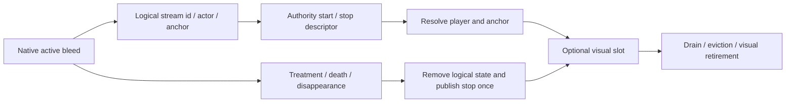

# Blood effects and clothing paint

Blood has two independent lifetimes: a logical effect associated with health/death state, and the bounded graphical resources currently displaying it. A missing, culled or evicted emitter is not proof that bleeding stopped. The master blood setting gates the effect system; disabling it also terminates tracked logical streams. Headless execution alone does not disable logical authority handling and creates no graphical objects.

## Native health to logical stream

[HeavyBleedingPatch](../src/Rupture/Dismemberment/Patches/HeavyBleedingPatch.cs) captures the living victim's previous heavy/light effect and hit location around native damage handling. A newly changed effect records a wound anchor. [BleedingWoundTracker](../src/Rupture/Dismemberment/Classes/BloodStreams/BleedingWoundTracker.cs) also discovers pre-existing effects by scanning living players every 0.5 seconds, using collider-based anchors when no captured hit exists.

Each tracked actor binds the concrete health controller, subscribes to effect updates/removal/residual transitions, and retains seven canonical wound slots. Heavy bleeding takes priority; light bleeding can remain after heavy treatment. Stable wound anchoring is retained across temporary pauses/reopening rather than moving the wound to an arbitrary current collider position. A replaced controller is unsubscribed and rebound; actor death or disappearance disposes the living tracker.

[NativeHealthEffects](../src/Rupture/Health/NativeHealthEffects.cs) shares the allocation-free read of matched controllers' existing effect lists with the fracture tracker. Each subsystem keeps its own effect predicates, native fallback queries, subscriptions and retirement cadence.

The authority/solo peer owns relevant native effect decisions. A remote client tracks its own victim effects and requests streams; it does not originate arbitrary other-player streams. Requests retry at a bounded cadence until acknowledged. Host checks bind a request to the sending peer/profile and a real active effect. See [transport ownership](ARCHITECTURE-MULTIPLAYER.md).

[PulsatingBloodStreamSystem](../src/Rupture/Dismemberment/Classes/BloodStreams/PulsatingBloodStreamSystem.cs) stores living streams in [EffectLifetimes](../src/Rupture/EffectLifetimes.cs) independently of graphical slots. Stream start is tracked before headless or graphics checks. Logical stop removes the entry before publishing stop, so competing update/removal paths cannot publish it twice. An observed stream follows authority stop while the observed actor exists.

Incoming descriptors are sequence-checked per profile/death. Stops remove logical state, pending resolution, soaking supply and emitters. Starts can wait up to four seconds for a local player/anchor. Visual resolution failure does not grant a different native health state. Local authority creates a normalized seeded descriptor, broadcasts it, and consumes it through the local receive path.

## Heavy, light and postmortem presentation

All blood streams use independent ballistic parcels, including postmortem head entry/exit wounds and postmortem dismemberment. Heavy bleeding retains heartbeat modulation; postmortem streams retain their slower, non-pulsating emission profile. [BloodParcelRenderer](../unity/RuptureWound/Assets/Rupture/BloodStreams/BloodParcelRenderer.cs) has an instanced draw path and CPU fallback. Captured history feeds one instanced parcel draw; the CPU fallback produces the same closed parcel geometry. Connected tubes and secondary spray droplets have been removed. Decals retain their independent arrival timing and budgets.

The nested `StreamRendering` owner in [PulsatingBloodStreamSystem.Rendering](../src/Rupture/Dismemberment/Classes/BloodStreams/PulsatingBloodStreamSystem.Rendering.cs) owns the world mesh, upload buffers and parcel renderer. It reads simulated emitter/history data from the enclosing service without changing logical stream state. The service retains emission timing, visibility, decals, pending descriptors and health-driven lifetime decisions. Teardown releases parcels before clearing simulation data, then destroys the mesh before resetting its material provider.

[Test-BloodParcelRuntime.ps1](../scripts/Test-BloodParcelRuntime.ps1) compiles the production renderer and history math in Unity. Its 14 checks cover wrapped history, all 2304 parcels, capacity overflow, zero steady-state managed allocation, closed CPU fallback geometry, captured ballistic movement, filtering and cleanup. It also reruns the 12 built-bundle CPU/GPU image comparisons and the 1/8/24-emitter CPU benchmark. The parcel-only change passed these checks on 2026-09-16; live raid appearance and performance remain separate validation.

Light bleeding launches individual gravity-driven droplets at approximately one-to-three-second intervals. Delayed analytic impact evaluation supplies their decal work. Heavy treatment can reveal an existing light effect without erasing its wound location.

Death registration precedes stopping living streams. Projectile kills produce a kill stream (default six seconds). Head kill streams can wait up to 1.4 seconds for the procedural wound's exit resolution. Committed death dismemberment uses the configured stump stream (default ten seconds); postmortem stump/head trickles use shorter continuous flow without a heartbeat. Those retained corpse anchors can survive Player disposal. Ordinary living/kill emitters whose player is lost are retired; the explicit postmortem flow case has separate anchor lifetime handling.

Fracture visuals contribute local per-site blood using the same graphical/soak infrastructure. They do not enter the authoritative living-stream table or add a fracture network packet. Fracture owner disposal stops them.

Blood applies to all graphical characters, including local body/sleeves. It adds no audio. Existing EFT health and treatment remain authoritative.

## Pool limits and scheduling

| Resource / work | Current bound or behavior |
| --- | --- |
| Visual emitter slots | 64. `MaximumVisualEmitters` sizes this visual pool; it does not cap the independent logical `EffectLifetimes` table. |
| Rendered emitters | Nearest eligible 24. Pool priority favors local living, other living, then corpse effects; eligible oldest entries can be evicted. |
| Visual restoration | Every 0.5 seconds, up to four missing living visuals can take free slots; no forced churn to restore all logical effects. |
| Parcel history | 96 samples per emitter; up to 2304 visible instanced parcels. |
| Ordinary decals | Three per frame, twelve per second, with spatial/time suppression (0.22 m / 0.65 s). |
| Dismemberment decals | Six per frame, twenty per second; tighter stump suppression (0.10 m / 0.24 s). |
| Collision sampling | Nonalloc ballistic segment queries, at most fourteen segments per sampled path. |

Emitter expiration drains visual history before retirement where appropriate. Visibility ranking and pool pressure can end an individual visual resource earlier than the logical bleed. Do not send stop merely because the pool is full or an emitter was culled.

On headless peers, update still runs tracker/logical stop handling before returning from graphical work. Static managed arrays can exist; the invariant is no creation of stream meshes/materials/paint targets from the headless graphical path, not zero managed memory use.

## Clothing soaking

[ClothingSoakingSystem](../src/Rupture/Dismemberment/Classes/BloodStreams/ClothingSoakingSystem.cs) receives supply from visible living emitters. It chooses the largest readable, decal-compatible equipped body/feet garment; arms can include local hands/sleeves. Heads do not create a fabric field. Targets with unsupported blend shapes or more than 32,768 vertices are rejected.

There are up to 64 transport fields and eight targets per field. Main-thread capture reads all Unity meshes, posed coordinates, materials and native decal bindings before `Task.Run`. The worker prepares topology, seed placement and correspondence using managed snapshots. Cross-LOD/sleeve mapping uses dominant-bone spatial neighborhoods and compatible normals. Main-thread publication rechecks target validity; a changed source mesh is not reused with stale UV correspondence.

Each due batch allows one initialization and up to eight field advances, with at least 0.05 seconds between batches. Each field samples pose/paint at approximately 0.5-second intervals and batches 0.1-second transport steps with bounded catch-up, as described below. No supply for five seconds retires the field. Worker retirement is deferred until preparation completes; reset waits for an outstanding preparation task before releasing resources. That reset wait is a synchronous boundary with no local timeout, not a guaranteed bounded shutdown cost.

[ClothingSoakField](../unity/RuptureWound/Assets/Rupture/BloodStreams/ClothingSoakField.cs) constructs the initial seed on the worker and remains the CPU validation oracle. Runtime transport lives in [ClothingSoak.compute](../unity/RuptureWound/Assets/Rupture/ClothingSoak.compute), with persistent buffers managed by [ClothingSoakGpu](../unity/RuptureWound/Assets/Rupture/BloodStreams/ClothingSoakGpu.cs). Immutable skin weights, topology, and garment correspondence upload once. Each due source captures and uploads its bone palette once per Update; GPU skinning supplies posed coordinates to independent double-buffered wound fields. Transport retains the previous gravity, speed, seam representatives, and 0.999 supply threshold. There is no recurring CPU vertex posing, saturation traversal, projection-color upload, or GPU readback. Unsupported compute/shader resources produce a bounded warning and leave existing native stains intact.

Ownership rule: stopping a field releases transport and temporary resources, but does not erase paint already accumulated in EFT's native decal texture. Treatment stops new supply. Native renderer/world lifetime owns the accumulated result. Clothing replacement and destructive mesh changes require revalidation rather than applying an old field to unrelated UVs.

Due fields record compute dispatches, a stamp draw and direct accumulation blend per target into one command-buffer execution per frame. Persistent scratch textures are shared by matching dimensions/format, cleared before each sequential stamp, and released on reset. The blend uses the native all-channel equation `stamp * stamp.a + destination * (1 - stamp.a)`, including alpha. New textures receive one native initialization blit; the accumulation shader preserves the reserved transparent corner marker written by EFT. The stamp pass remains separate to retain overlapping-UV behavior. Neither accumulation pass samples its own render target. Renderer/mesh/bone data, projection meshes, topology, and GPU skinning are reference-counted across wounds. Saturation and per-target previous-paint buffers remain independent. The vertex shader reads current and previous saturation directly; unchanged fragments discard. There is intentionally no readback to decide whether a target changed. Paint history advances on the GPU after recorded composition; missed registration leaves it untouched, while replacement native textures reset it so the complete stain is deposited. Buffer swaps commit only after successful command submission. A partially failed submission stops the affected fields with a warning.

Health tracking caches the ordered bleeding-effect membership, rebuilding it on add/start/update/remove/residual events, list-count changes, or a 0.5-second reconciliation. Every bleeding candidate still checks `Active` each frame, including inactive candidates, so silent native pause/resume retains immediate first-match and heavy-priority behavior. Actor and logical living-wound lookups are indexed; inactive body parts do not query stream acknowledgments. Unknown controllers retain native queries. History compaction runs only when the earliest sample can expire, preserves out-of-order flight expiry and avoids clearing unused value-only slots.

Schema 10 replaces per-target history compute dispatches with GPU buffer copies in source-vertex space. Both current and previous fields use the same correspondence map in the vertex shader; skipped and replaced destinations retain independent histories. Geometry and wound ping-pong shaders own immutable buffer bindings established at initialization. Recurring work records only the bone upload, dynamic gravity/speed parameter and dispatches, avoiding repeated buffer bindings. Native stamp/accumulation order and overlapping-UV behavior are unchanged. History copies trade some extra GPU storage on lower-detail targets for fewer commands; they do not read back to the CPU.

Schema 11 samples the garment pose and paints each wound at approximately 2 Hz. Each update batches fixed 0.1-second GPU transport steps against that sampled pose, so reducing paint frequency does not divide the stain's growth rate. The scheduler carries a fractional-step remainder, limits catch-up to 0.8 seconds, and paints at most eight fields per batch with at least 0.05 seconds between batches. Source topology, seam handling, gravity bias, per-target history and native accumulation remain unchanged. Motion within a half-second interval is approximated by the sampled pose; there is no CPU destination search or per-frame interpolation paint. Pixels cross the same saturation threshold once, but the visible frontier advances in coarser increments. Tests cover even/odd step batches and history ownership as well as bounded update frequency. Live garment appearance remains a separate validation step.

Prediction uses the closest-hit raycast overload with the same segment boundaries, mask and trigger policy. Sampling rates are unchanged; the query no longer gathers up to eight hits and scans them on the CPU. Dense geometry cannot displace a closer hit from a bounded result buffer.

Reference parcels retain the 55 ms under-pressure / 120 ms relaxed sampling intervals and the nominal 50 Hz visual launch rate. Only the next emitted parcel after the reference deadline queries the ballistic path; wound movement and heartbeat transitions do not force extra predictions. Each later parcel keeps its own launch position, velocity, and immutable expiry, copying the last reference's flight duration. Misses replace stale hit lifetimes with the finite maximum. Stationary postmortem paths retain their existing spatial/profile cache, inspected only at the reference deadline. Timed references queue immutable world-hit records for arrival-time painting, preserving spatial and per-frame/per-second budgets. All kinds share a bounded 128-entry impact queue with a 0.5-second late-deposit expiry. A stopped wound cannot move or retime its airborne impacts.

`Test-BloodEmitterRuntime.ps1` compiles production methods and checks moving/stationary heavy and postmortem flows at 60/120 FPS, wrapped history, health-controller lifetime, 18 reference-lifetime cases, and 12 postmortem deposit cases. Its optional `-BaselineSource` now requires identical sampling counts, launch hashes and expiry-inclusive trajectory hashes against the preceding reference-parcel implementation. The closest-hit regression also covers more than eight blockers and ignored triggers. The September 18 fixture retained heavy-wound emission counts and launch hashes with zero steady-state allocation; moving-heavy raycasts decreased 58.75% at 60 FPS and 71.25% at 120 FPS in the isolated 24-emitter floor scene. Stationary postmortem prediction counts were unchanged. Full clothing behavior is checked against the built bundle in Gamma, with additional native-merge comparisons in Linear, including overlapping wounds, native corner markers, skipped registration, destination replacement, and independent treatment. All RGBA differences must remain within three 8-bit quantization levels. Compute tests compare over 2.38 million saturation values with the CPU oracle under changing poses and gravity, mixed skin weights, seams and disconnected layers. The optional clothing `-FrameBenchmark` runs across actual editor frames; `-BaselineSource` accepts the frozen preceding runtime for comparison. Missing GPU profiler samples mean unavailable timing, not zero cost. These checks do not establish live raid savings or actual garment correspondence.

## Decals, shaders and cleanup

[BodyDecalRendering](../src/Rupture/Dismemberment/Classes/Limbs/BodyDecalRendering.cs) and [BodyDecalLodPatch](../src/Rupture/Dismemberment/Patches/BodyDecalLodPatch.cs) support native paint on eligible enabled renderer LODs, including tiers hidden by LOD visibility, and use the current posed surface for native painting. Limb/head adoption preserves or copies existing paint with explicit texture ownership and can defer new wound decals until targets are ready.

[DecalCapacityPatch](../src/Rupture/Dismemberment/Patches/DecalCapacityPatch.cs) sets both native static/dynamic environment pool capacities at `DeferredDecalRenderer.Awake` when blood graphics are enabled. The default is 2,048 per pool; values below one use one. This is the native shared pool, including impact marks, and applies when the next world allocates it. It is distinct from per-frame blood decal emission budgets.

[DecalMeshIndexFormatPatch](../src/Rupture/Dismemberment/Patches/DecalMeshIndexFormatPatch.cs) selects 32-bit indices before native triangle assignment when a pool exceeds 2,730 projectors (24 vertices each). The native 16-bit default corrupts indices at 4,096 projectors. Capacity-boundary and partial-upload wraparound tests cover 128, 2,048, 2,730, 2,731 and 4,096 projectors. Postmortem floor-deposit tests exercise actual transport, raycasts and decal scheduling at three wound heights, both stump durations, and with/without rate-limit pressure. The native effect-call boundary is recorded by the fixture; live appearance remains a separate check.

Schema 7 added `BloodPostMortemImpactHits`, `BloodPostMortemImpactMisses`, `BloodPostMortemDecalBlocked` and `BloodPostMortemDecals`. These count predicted paths, budget/spatial rejection attempts and native deposit calls, respectively; they do not establish that a decal was visible on screen.

Schema 8 added `BloodTraceInitial`, `BloodReferenceParcels`, `BloodReusedFlightTimes`, `BloodImpactsQueued`, `BloodImpactQueueFull`, `BloodImpactsExpired`, `SoakTemporaryTargets`, `SoakStampDraws` and `SoakBlendDraws`. References count scheduled representative parcels (including cached stationary postmortem paths); predictions and raycasts count actual queries. Reused flight times count intervening visual launches.

Schema 10 reports `optimization=bounded-tracking-gpu-history-copy`. `SoakGpuHistoryCopies` counts GPU buffer copies separately from compute dispatches. `SoakGpuSkinVertices`, `SoakGpuBoneUploadBytes`, `SoakGpuTransportVertices`, `SoakGpuPaintVertices`, `SoakGpuDispatches`, and `SoakGpuScratchAllocations` count scheduled GPU work, logical bone upload volume, and scratch creation. `SoakPaintTargets` now counts attempted due targets, not known changed targets. Old CPU posing/transport/color-upload/changed-target/temporary counters remain zero. Two draws are submitted per available target; one-time native initialization is charged to registration. `SoakGpuSkin` and `SoakGpuTransport` measure CPU command recording; they are not GPU execution timings. `RPT.GPU.ClothingSoak` is a GPU-enabled profiler sample surrounding skinning, transport and composition; it excludes the ordinary game rendering that later samples the native decal textures.

[WoundResources](../src/Rupture/WoundResources.cs) loads four bundled rendering shaders: `Rupture/HeadWoundInterior`, `Rupture/LimbSeverSurface`, `Rupture/PulsatingBloodStream`, and `Rupture/ClothingSoak`, plus the `ClothingSoak` compute shader. Material providers create owned materials while borrowing EFT-loaded texture resources. The bundle redistributes no EFT textures. A load finishing after shutdown unloads its result.

Reset unsubscribes health trackers, clears logical/sequence/pending state, retires emitters/soak fields, disposes owned meshes/materials/command buffers, and resets providers before resource-bundle shutdown. Deferred worker results cannot be adopted into a retired field. Shared native paint is not globally wiped as part of effect reset.

Use [Test-ClothingSoaking.ps1](../scripts/Test-ClothingSoaking.ps1), [Test-WoundBenchmarks.ps1](../scripts/Test-WoundBenchmarks.ps1), the regression suite and the [runtime checklist](RPT-Ragdoll-Runtime-Inspection.md). Controlled geometry/allocation/image tests do not measure live GPU frame cost or establish visual acceptance on real garments.
