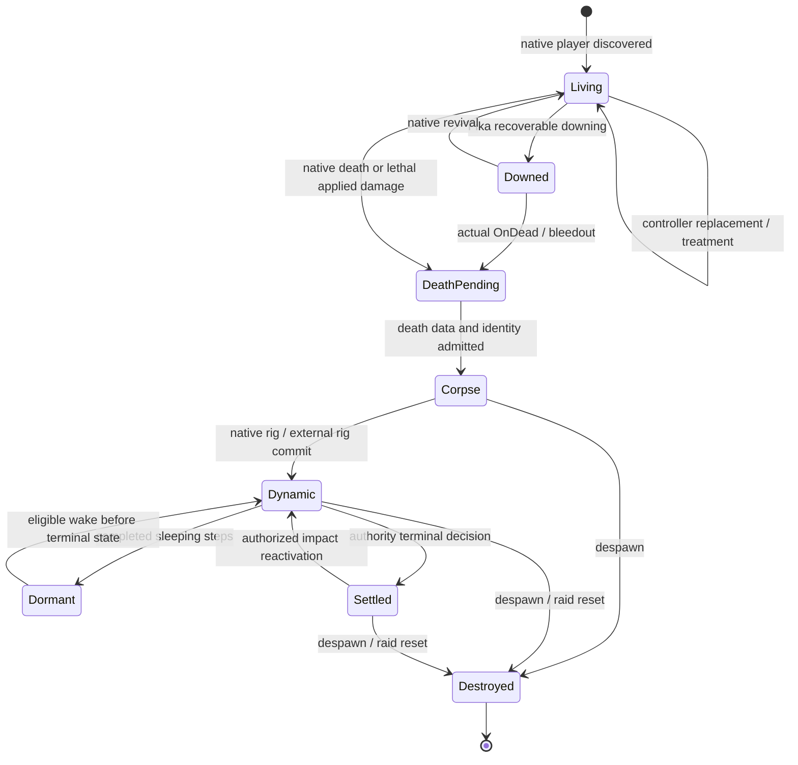

# Character, corpse and resource lifecycles

This guide follows transitions rather than classes. [RupturePlugin](../src/Rupture/RupturePlugin.cs) drives updates/resets; [RagdollCoordinator](../src/Rupture/Ragdolls/Classes/RagdollCoordinator.cs) owns corpse event state. [Geometry](ARCHITECTURE-GEOMETRY.md), [blood](ARCHITECTURE-BLOOD.md), [physics](ARCHITECTURE-PHYSX.md) and [multiplayer](ARCHITECTURE-MULTIPLAYER.md) describe the work retained at each boundary.

Geometry and postmortem blood can run across dynamic, dormant and settled states. They are not extra simulation states. Controller replacement is not a new corpse identity; corpse retirement is not merely loss of the original Player reference.

## Transition ownership

| Transition | Create / retain / transfer | Invalidate / destroy |
| --- | --- | --- |
| Player discovery | `BleedingWoundTracker` and `FractureSystem` scan living players, bind concrete health controllers and record effect slots/masks. Impact hooks lazily create victim totals from applied damage. | No generated geometry is assumed present merely because a player was found. Invalid/dead entries are excluded. |
| Controller replacement | New controller receives fresh subscriptions/effect reconciliation; profile/native actor remains the identity input. | Old controller subscriptions are removed. Living fracture visuals and old effect tracking are retired; stale callbacks cannot remain the active source. |
| Bleed/fracture starts | Native effect identity and anchor are retained. Blood obtains a logical stream before optional graphics; fractures enqueue actual covering capture. | New topology/mask invalidates incompatible visual preparation. Visual pool pressure does not erase logical bleeding. |
| Healing/treatment | Native effects drive stops/severity changes. Ordinary limb totals retain momentum through partial healing and clear at the living maximum. Separate living-leg buildup clears on any positive HP recovery or completed applicable bleeding/fracture treatment; healing invalidates pending living cuts. Existing native clothing paint remains. | Stop removes logical stream once, retires pending/visual supply; resolved fractures remove additive geometry, anchors and local site blood. |
| Living leg cut / fall | Authority reserves eligibility, admits geometry/temporary physics and commits missing anatomy. `BotSeverStateService` owns stump health loss and surgical treatment; `ShadowRagdollWorld.Living` owns temporary fall bodies. | Healing invalidates pending cuts. Failed admission preserves intact anatomy/health. Recovery releases the temporary rig and retains permanent prone state. Clients present authority state without ticking health damage. |
| Living severed bot dies | Committed anatomy and disabled hit colliders survive into corpse reconstruction; completed fall pose can seed the native corpse shells. | Terminal death cancels queued/uncommitted living cuts and releases temporary living physics before corpse construction. |
| Lethal native damage | Applied-damage path captures lethal sample/totals. Coordinator registers death; Fika owner snapshot can defer authority processing. | Living streams are stopped after death registration. Fracture actor state is disposed, not transferred to a corpse. |
| Fika downing / revival | Keep accumulated impact state and blood wound anchors; downing consumes no terminal death flags. Revival reconciles bleeding and fractures from current native effects. | Stop living blood while downed; do not restore effects removed by Fika. A real `Corpse` owner is required for native ragdoll ownership. |
| Native `OnDead` before postfix | Record terminal death for the current Player lifetime, overriding a lingering Fika downed flag. `ImpactStateService` queues a lifecycle-only fallback for a later update with neutral impact context. | Fallback is skipped if the ordinary lethal path already applied death. It cannot invent a projectile sample. |
| Corpse transition | `CorpseHeadContext`/retention and `CorpseLimbContext` capture required bones/callbacks before Player retirement. Coordinator binds profile/player/death and impact lifetime. Native rig capture is deferred one frame. | True identity replacement invalidates stale work; replacing a provisional sequence for the same player preserves its required impact lifetime/totals. |
| External rig commit | External actors take simulation ownership; native shell retains gameplay and presentation identity. Original native registration/collision data is retained for failover. | Partial rig creation destroys staging. Committed failover restores native state before proxy release. |
| Limb sever request | Reserve corpse/limb; one queued request owns snapshots, generated meshes, collider work and actor ticket. Headless authority can commit logically. | Cancellation/expiry clears reservation and prevents late adoption. Failed graphical reconstruction retains the intact native limb collider. |
| Limb commit | `LimbCutLifetime` adopts body/socket/LOD resources; gib host/runtime own detached resources; committed sever record supports subsequent cuts. | Old owned meshes are retired only after replacement succeeds. Collider/decal/blood follow-up is postcommit, not part of rollback. |
| Head wound | Policy reservation and cumulative immutable source survive individual graphical attempts. `HeadWoundLifetime` adopts skin/cavity and retains original renderer enabled states. | Failed candidate leaves earlier committed wounds. Removal restores original renderer state and destroys owned/source meshes. |
| Postmortem flow | Explicit corpse anchors can survive original Player disposal; stream duration/draining controls visual retirement. Corpse state remains addressable when parked. | Anchor destruction stops attached visual resources; losing Player alone is handled according to trigger, not as universal corpse despawn. |
| Sleep / settle / wake | Dormant shell retains rig; terminal state parks coordinator work. Wake-capable corpses retain native query shells and identity for another bounded motion epoch. | Active scanning/publication membership ends on settle. Tombstones reject stale sequences; remote client clocks cannot end authority motion. |
| Despawn | [ObjectLifetime](../src/Rupture/ObjectLifetime.cs) and retained components notify owners; physics also checks dead references. | Retire impact lifetime and coordinator bindings, cancel queued injury/pose work, destroy owned visuals/actors, restore borrowed state where still valid. |

`ObjectLifetime` callbacks are keyed: rebinding replaces a callback instead of accumulating identical destruction work. Cleanup catches individual callback exceptions so one owner does not prevent other registered owners from retiring.

## In-flight work and destruction

| Work | Publication guard | Cleanup owner |
| --- | --- | --- |
| Managed limb geometry | Request cancellation/valid corpse checked before consuming result; immutable source remains readable by an already running job. | Request releases unadopted data/resources; source cache reset does not mutate worker-held arrays. |
| Unity convex prebake | Completion must precede destruction of the mesh being baked. | `DeferredGibCleanups` polls completion before releasing gib resources. |
| External transient actor | `OwnedResult` arbitrates publication/take/close. | Producer destroys late rejected actor; canceller destroys unclaimed published actor; successful consumer owns adopted body. |
| Clothing topology task | Retired field cannot publish into live target; target/source revalidated on main. | Deferred retirement waits for completion; reset synchronously waits before releasing preparation resources. |
| Network corpse/head/limb event | Session/sequence, corpse/death identity and lifetime, admission and deadlines. | Network/coordinator queues discard stale/expired requests without mutating an unrelated actor. |
| Shader bundle load | Shutdown state checked after asynchronous load. | Late completion unloads bundle instead of publishing; active visuals/providers dispose before normal resource shutdown. |
| Diagnostic cut export | Bounded independent queue/session capture. | Reset discards queued jobs; a running writer retains its captured session, not new-raid ownership. |

Important invariant: cancellation prevents adoption; it does not necessarily stop a worker immediately. Resource destruction must follow the actual worker/publication lifetime.

## Raid teardown

World loss causes plugin resets of shot/headgear/head/blood/fracture/coordinator/diagnostic/decal services. `RagdollCoordinator.Reset` first resets limb work, impact-network raid state, corpse-weapon collision filtering and `ShadowRagdollWorld`, then clears its maps, pending events, playback/prediction state and counters. This ordering gives services an opportunity to retire work while their bindings still exist.

The plugin's `ResetRuntimeServices` first resets `BotSeverStateService`, then shares the ordered shot/headgear/head/blood/fracture/coordinator/diagnostic retirement used by world loss and plugin destruction. World loss separately resets native decal helper state. Plugin destruction retains its later backend, bundle, hook, decal-patch and network shutdown sequence; the shared helper does not merge those scopes.

Physics reset completes the in-flight step and tears down the owner scene, then clears extraction/caches/wrappers. Failure to complete within watchdog limits quarantines the backend instance instead of racing destruction against simulation. Source caches, fracture variants and living subscriptions are raid-scoped. Plugin resource providers can be recreated as needed; native EFT assets and accumulated native paint belong to their world/renderer lifetimes.

Adapter raid reset is not a complete network-session reset. Network-manager destruction/disposal separately clears peers, session sequences/configuration revisions and restores local preferences. No retained raid event queue becomes reconnect replay.

## Plugin shutdown

`RupturePlugin.OnDestroy` removes `ShadowVisiblePosePlayerLoop`, resets impact/visual/coordinator services, shuts down `ExternalPhysicsBackendLoader` and `WoundResources`, and shuts down retained impact hooks, body-decal patch state and `MultiplayerRuntime`. Backend disposal joins its owner with a bound and unloads native code only if the owner stopped. This preserves safety even if shutdown cannot finish a stalled native operation.

The repository does **not** implement a comprehensive hot-unload guarantee. Ordinary `ModulePatch` instances are not all retained for unpatching; clothing integration has no corresponding complete uninstall path; the serial managed geometry worker has an infinite background loop. Deferred Unity collider-mesh cleanup depends on later polling once the bake finishes, while final plugin destruction may provide no further update. Clothing preparation reset can wait without a local timeout. These are concrete limits of the current cleanup implementation, not claims that every resource leaks in normal raid teardown.

Maintenance rule: distinguish raid reset, object destruction, network reset and process/plugin shutdown. A cleanup path proven for one does not prove the others. Test pending capture, pending actor publication, controller replacement, Player disposal with a surviving corpse, and repeated raids separately.
