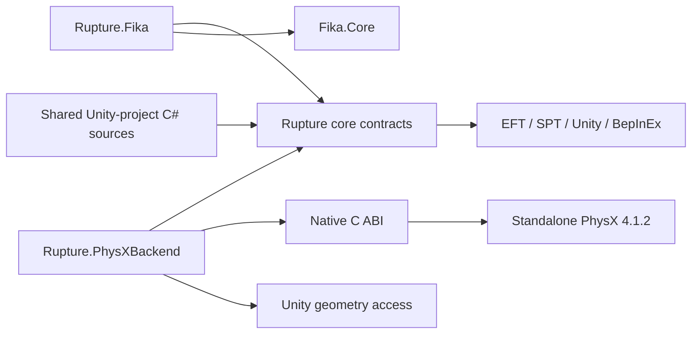
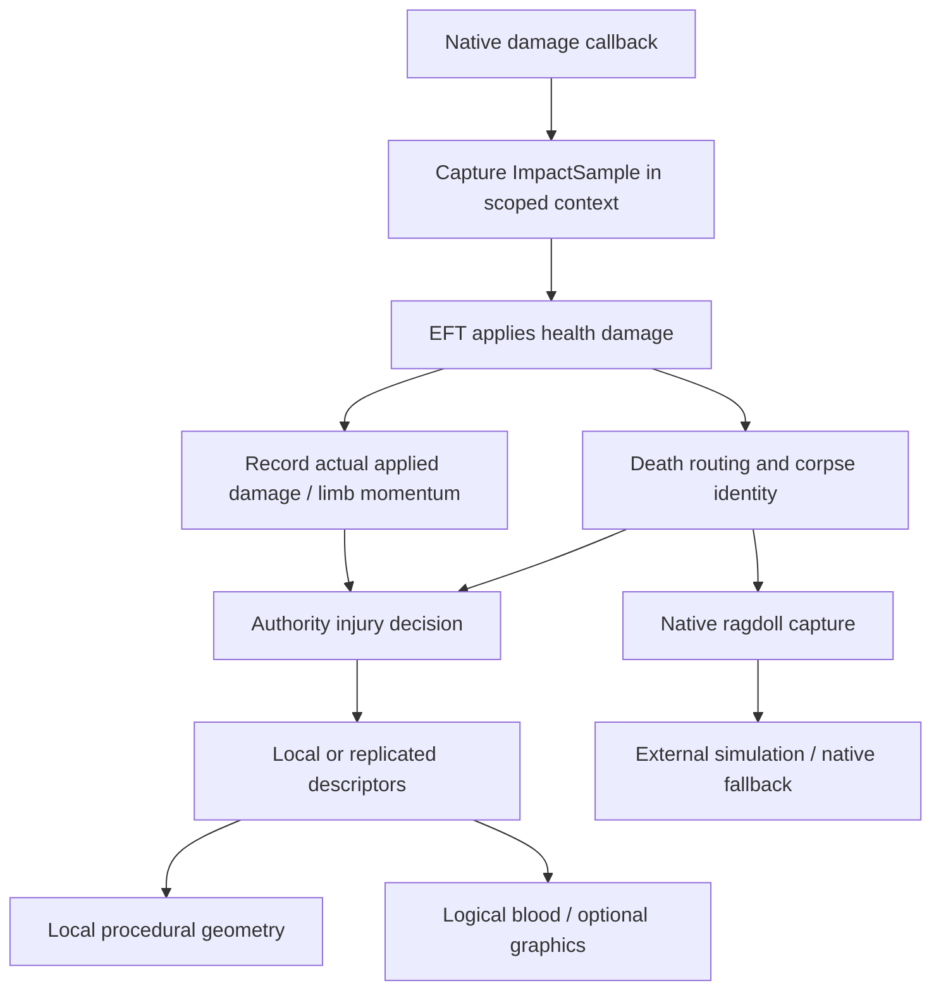

# Rupture architecture

Rupture is a client-side BepInEx plugin for the matched EFT/SPT installation. EFT owns characters, health, inventories, corpse identity, gameplay colliders and native decal storage. Rupture observes those lifecycles, generates injury visuals, and can take temporary ownership of corpse simulation through a standalone PhysX scene. The optional Fika adapter carries authority decisions and motion; graphical peers build their own procedural meshes.

This is the entry point for the implementation in this repository. The focused guides cover [geometry](ARCHITECTURE-GEOMETRY.md), [PhysX](ARCHITECTURE-PHYSX.md), [blood](ARCHITECTURE-BLOOD.md), [multiplayer](ARCHITECTURE-MULTIPLAYER.md), [lifecycle](ARCHITECTURE-LIFECYCLE.md), and [design decisions](ARCHITECTURE-DECISIONS.md). Use [development setup](DEVELOPMENT.md) for reproducible build inputs and the [runtime inspection checklist](RPT-Ragdoll-Runtime-Inspection.md) for live verification. The [corpse-control API](CORPSE-CONTROL-API.md) defines the consumer contract; [performance evidence](PERFORMANCE.md) preserves historical measurements and their limits.

## Projects and dependency direction

| Location / output | Responsibility |
| --- | --- |
| `src/Rupture` / `Rupture.dll` | Plugin, configuration, EFT patches, impact policy, corpse coordination, procedural runtime, resource lifetimes; defines multiplayer and external-physics contracts. |
| `src/Rupture.Fika` / `Rupture.Fika.dll` | Optional adapter referencing core and installed `Fika.Core`; transport wrappers, damage envelopes, handshake and authority routing. |
| `src/Rupture.PhysXBackend` / `Rupture.PhysXBackend.dll` | External-physics contract implementation, main-thread Unity geometry capture, scene-owner thread, native marshaling and environment caches. |
| `src/Rupture.PhysX.Native` / `rpt_physx_bridge.dll` | C ABI bridge owning standalone PhysX objects; CMake build and native integration tests. |
| `unity/RuptureWound/Assets/Rupture` | Shared procedural head/limb geometry, clothing profiles, blood parcel and soak algorithms, shaders, editor validation. Selected C# files are linked into core, not a separate runtime Unity assembly. |
| `tests` | Managed regression executable, clothing fixtures/harness and PowerShell structural/integration checks. |
| `scripts`, `assets/bundles` | Reproducible build/validation/package entry points; compiled shader resource and validation artifacts. |

These are compile-time dependencies. Core discovers the Fika and physics implementations at runtime through [MultiplayerRuntime](../src/Rupture/Multiplayer/MultiplayerRuntime.cs) and [ExternalPhysicsBackendLoader](../src/Rupture/Ragdolls/External/ExternalPhysicsBackendLoader.cs). Core has no compile-time Fika dependency. The optional adapter is granted access to core internals. The physics project can reference the core project or a prebuilt core assembly.

Within core, `Health/NativeHealthEffects` exposes borrowed native effect lists to blood and fracture tracking; `Dismemberment/Classes/RendererSource` shares source-state reads/copies without owning renderers. Corpse interaction identity, pose-chunk assembly and body hierarchy naming have separate sources under `Ragdolls/Classes`. Limb jobs and postcommit decals use focused partials of the same service, while limb resource lifetimes have their own file. The blood service's rendering partial contains its nested mesh/instancing owner. These boundaries retain explicit ticking and specialized adoption policies.

The three managed runtime projects target `netstandard2.1`. [Directory.Build.props](../Directory.Build.props) resolves exact installed game references using `SptInstallPath` / `SPT_ROOT`. `FikaPluginPath` optionally selects an external Fika reference directory and is propagated by validation/package builds. SPT 4.1.6 / EFT 0.16.9.40743 and Fika Core 2.4.4, server 2.4.2, headless 1.5.3 are build baselines; newer versions are not rejected by number. Vendor/game assemblies remain external build inputs. Core also uses AssetsTools.NET for the clothing bundle path.

## Composition and startup

[RupturePlugin](../src/Rupture/RupturePlugin.cs) is the composition root. Services are predominantly static, explicitly ticked and reset; there is no dependency-injection container or autonomous service scheduler.

`Awake` initializes logging and configuration, selects `IMultiplayerRuntime`, installs clothing bundle handling, begins asynchronous wound-resource loading, and installs impact, blood, death, corpse and compatibility patches. Fika adapter initialization failure disables this plugin rather than silently running solo policy in a Fika session. Exact native ragdoll lifecycle targets are checked before shadow integration; missing targets disable that integration while preserving EFT corpse physics. These are different failure scopes.

`Start` installs the visible-pose player-loop hook. `Update` distinguishes a present world from a playable raid: it latches `AbstractGame.Status == Started`, excludes Hideout, and requires a main player on graphical peers. Headless execution does not require one.

The per-frame order is deliberate:

1. Impact network processing, then `ImpactStateService` deferred death processing.
2. Shot impacts and pending lethal headgear detachment.
3. Head wounds, blood effects and living fractures.
4. `RagdollCoordinator`, then `ShadowRagdollWorld.Update` for capture/build/environment work.
5. `LimbDismembermentSystem.Update`, `BotSeverStateService.Update` and diagnostics.

`LateUpdate` advances the external simulation pipeline, copies visible shell poses, and updates fracture anchors. The later player-loop callback reasserts visible poses; it does not simulate physics. See the exact cadence in the PhysX guide.

`GameStartedPatch` resets coordinator/impact work and initializes the shadow world for the new raid. World loss clears visual and impact services; coordinator reset also clears sever work and physics state. `OnDestroy` removes the custom player-loop hook, resets services, shuts down the backend and wound resources, and shuts down retained impact/decal/Fika integrations. This is not a general hot-reload contract: ordinary Harmony patches are not all retained for unpatching, and the managed geometry worker has process lifetime. See [shutdown boundaries](ARCHITECTURE-LIFECYCLE.md#plugin-shutdown).

## Subsystems and state flow

| Subsystem | Input / retained state | Output / owner |
| --- | --- | --- |
| `ImpactStateService` | Native projectile scope, applied health damage, per-victim limb totals, death snapshot | Authoritative death/sever policy input; no health replacement. |
| `RagdollCoordinator` | Corpse identities, events, authority motion, deadlines | Event admission, prediction/playback, pending visual reconstruction and corpse retirement. |
| `ShadowRagdollWorld` | Native ragdoll description and environment | External rig ownership, native query-shell poses, impulses, sleep/wake/failover. |
| `LimbDismembermentSystem` | Authorized limb/level/seed request and actual renderer sources | Transactional body cuts, attached socket geometry, detached local gib, native collider removal on success. |
| `HeadWoundSystem` | Head-local trajectory and seeded wound descriptors | Cumulative replacement head skin and cavity, retaining corpse head context. |
| `BleedingWoundTracker` / `PulsatingBloodStreamSystem` | Native health effects, logical stream descriptors | Authoritative stop lifetime and bounded local graphics/decals. |
| `ClothingSoakingSystem` | Supply from visible emitters and actual garment topology | Persistent paint in EFT-owned decal textures; disposable transport fields. |
| `FractureSystem` | Living native fracture effects and equipped renderers | Additive bone/collar visuals and local blood, removed on treatment/death. |
| `BotSeverStateService` / `BotSeverHooks` | Authority living-leg eligibility, cut reservations, committed anatomy and surgical completion | Permanent missing-leg/prone state, stump health loss/treatment, temporary fall physics and replicated presentation. |

### Injury and death

[ImpactHooks](../src/Rupture/Impacts/ImpactHooks.cs) captures projectile data in the thread-static `ImpactStateService.Current` scope and restores the previous value in finalization. Applied-damage postfixes use the actual native health result. Eligible bullet samples have positive damage and exclude blunt/overdamage paths; missing projectile momentum is not fabricated. Projectile deduplication prevents repeated accumulation. Full healing to a living limb's current maximum clears its accumulated total; partial healing does not.

[KillPatch](../src/Rupture/Combined/Patches/KillPatch.cs) detects death after native damage handling. Native `OnDead` may run before the lethal damage postfix, so `ImpactStateService` queues lifecycle-only death processing for a later update and skips it if normal death handling already ran. In Fika, the victim owner supplies death totals; the authority waits for required identity/death data before applying policy.

Death is registered before living streams are stopped. Projectile head death routes to head wound/headgear and a kill stream. A lethal limb can sever according to accumulated momentum; explosions independently test the four limbs using the explosion center and anatomical segments. A successful sever commits the outcome and publishes it. Failed graphical preparation preserves limb buildup and intact geometry/colliders, with kill-stream fallback where applicable. Headless authority can commit the logical sever without graphical generation.

[LimbImpactPolicy](../src/Rupture/Impacts/LimbImpactPolicy.cs) uses a configurable projectile momentum threshold (default 12 N·s, range 0.1–120 N·s) and squared normalized probability. The authority-synchronized setting applies to accumulation, sever rolls and death-snapshot imports. Changes affect subsequent operations; previously capped momentum is not recovered. [ExplosionSeverPolicy](../src/Rupture/Impacts/ExplosionSeverPolicy.cs) uses distance to limb segments: guaranteed through 0.6 m, smooth falloff to 2 m, independent level selection. Keep transport, native damage and random outcome ownership separate when extending these policies.

### Character and corpse identity

Player and health-controller references are temporary. Living trackers bind to the concrete controller and unsubscribe on replacement. Corpse identity includes profile, player and death sequence. Pending work also retains a corpse/lifetime identity so reuse of a network ID cannot resurrect old work.

`CorpseHeadContext` / `CorpseHeadRetention` retain head anatomy, native inventory callbacks and decal context before player disposal. `CorpseLimbContext` retains actual limb bones. Settled corpses remain addressable after leaving the coordinator's active update set; tombstones reject stale event sequences. Destruction callbacks retire identity and owned resources. The [lifecycle guide](ARCHITECTURE-LIFECYCLE.md) maps each transition to its cleanup owner.

## Ownership and threading

| Resource | Ownership rule |
| --- | --- |
| Native player/corpse, original meshes, loaded EFT textures | Borrowed from EFT; do not destroy or redistribute. |
| Generated mesh/material/attachment | Request owns staging; successful adoption transfers to a lifetime component or material provider; that owner destroys it. |
| Detached limb | Local visual host owns baked/query meshes; external runtime owns its simulation actor after registration. These lifetimes must be retired together. |
| Native physics handle | Owned by the standalone scene on its owner thread; the core receives managed proxy state, not permission to release native pointers. |
| Logical bleed | Owned by `EffectLifetimes`; visual eviction is not a stop event. |
| Network identity and event admission | Owned by coordinator/adapter state; raid/network resets have distinct scopes. |

Unity object discovery, mesh upload, renderer changes and native shell synchronization run on the main thread. Limb geometry uses immutable managed snapshots on one retained worker; Unity collider prebake is an explicit worker operation. Clothing soaking captures Unity data before `Task.Run` and publishes prepared managed results back to the main thread. All standalone scene mutations and stepping belong to the dedicated physics owner thread. See the focused guides for publication and cancellation rules.

Important invariant: a worker retaining immutable arrays is not retaining permission to touch the originating Unity object. Resetting a source cache must not mutate data still held by work in flight.

## Configuration and resources

[RuptureConfiguration](../src/Rupture/RuptureConfiguration.cs) owns BepInEx entries. Fika synchronizes sixteen visual/simulation policy values as a validated, ordered snapshot. Graphical hosts supply their settings; headless normally adopts the first valid requester snapshot unless its local-policy toggle is enabled. Casing settings, debug switches, geometry budgets, environment policy and dispatcher thread count stay local. Client overrides live in memory; `ConfigurationSavePatch` saves local preferences and restores host values afterward. Environment mode and dispatcher changes apply on the next raid.

[WoundResources](../src/Rupture/WoundResources.cs) loads the adjacent wound bundle asynchronously and skips loading on headless peers. The bundle contains four rendering shaders and the clothing transport compute shader. Material providers borrow textures already loaded by EFT and own the materials they create. Late resource completion after shutdown unloads the bundle rather than publishing it to a dead service. Materials/visuals are reset before bundle shutdown.

[ClothingBundleLoader](../src/Rupture/Clothing/ClothingBundleLoader.cs) and its hooks/request/work/data helpers handle clothing bundle preparation using AssetsTools.NET. This supports readable actual garment meshes required by cutting and soaking. It is asset preparation, not a renderer substitute or a generated garment catalog. Keep its bundle request lifetime separate from raid-local geometry caches; the Unity harness does not exercise every installed-game bundle-loading path.

### Clothing bundle preparation

Headless peers return before clothing hook installation or decoder initialization: their logical injury handling does not need readable mesh data. On graphical peers, runtime Body/Feet customization keys and declared dependencies are indexed without scanning clothing bundle contents. A prefix observes requested loads before native scheduling. Requested discovery follows `LoddedSkin`, `Skin`/`TorsoSkin` and renderer references to the owning serialized mesh, including base/armor/vest variants and shared owners. Mesh names alone are not identities. Discovery shares one lazy task and its immutable result per garment across overlapping requests, including already-readable results. Failed entries are removed for retry; cancellation of one request does not cancel discovery needed by another. Two workers bound discovery concurrency; rewrites are serialized. This caches metadata rather than preloading or retaining all clothing bundles.

The data layer verifies the original bundle hash and permits exactly the serialized readability-byte change for an identified unreadable mesh. It rewrites bytes in memory, leaving installed bundles and download caches untouched. Already-readable meshes use the original load path. Preparation is awaited through native bundle validation, and a scoped hook on Unity's managed file-load overload consumes the prepared bytes once for the matching path. Unrelated loads proceed normally; the native async state machine is not replaced.

Discovery and rewrite each have a 30-second budget including queue wait. Timeout/failure cancels pending recovery, diagnoses and resumes native loading; a decoder already running may finish, but a late result cannot be installed after fallback. Readability increases retained CPU mesh data while the mesh is loaded and does not guarantee acceptable cut topology. The [clothing-loader validation script](../scripts/Test-ClothingLoader.ps1) checks production discovery/rewrite and hook behavior with Unity/EFT boundary doubles plus installed ABI checks; full-mod-set startup remains a live verification boundary.

#### External LZMA decoder decision

Use the public-domain **LZMA SDK 26.03 C decoder**, vendored with its provenance in [vendor/lzma](../src/Rupture.PhysX.Native/vendor/lzma/README.md), for clothing LZMA decompression. It is compiled with the static CRT into the existing `rpt_physx_bridge.dll` and exposed through [rptpx_lzma_decode_v1](../src/Rupture.PhysX.Native/src/rpt_lzma.cpp). This additive, versioned codec export leaves physics ABI 10 unchanged and requires no PhysX scene. [ClothingBundleDecompression](../src/Rupture/Clothing/ClothingBundleDecompression.cs) loads it explicitly from the plugin directory and retains its own process-lifetime library reference, independently of the optional physics backend.

The native path handles bundles whose data blocks use LZMA or no compression. It accepts the five LZMA property bytes plus compressed data, writes into caller-owned output, and requires successful completion with exact consumed and produced sizes. AssetsTools.NET remains responsible for container/serialized-asset handling. When the native decoder is unavailable or the block layout is unsupported, the managed path places a **64 KiB `BufferedStream` above the decoder's `SegmentStream` input**, avoiding a separate segmented read/allocation for every compressed byte. Native decode errors fail recovery and resume the original bundle load; they are not silently retried as successful managed recovery.

The choice avoids coupling production to Unity's private decoder entry points or patching its deserializer. On 2026-09-10, a signature scan of 37,517 files under the local SPT installation found 7,771 bundles: 1,137 LZMA, 6,633 uncompressed and one LZ4HC. All LZMA bundles, including physical cache/backup copies, produced byte-identical output to the exact installed Unity 2022.3.43f1 decoder. Three paired trials per bundle gave summed median times of **163.63 s for Rupture versus 162.67 s for Unity (+0.59%)**, decoding 9.20 GiB. That supports using the external decoder without a meaningful measured codec-speed penalty. The isolated benchmark's private Unity function invocation is test-only; disk I/O, parsing, rewrite and Unity asset loading were excluded, so these figures do not establish raid-start performance or resolution of the ABPS timing symptom.

### Logging

[RuptureLog](../src/Rupture/RuptureLog.cs) wraps BepInEx logging. Verbose diagnostics are local; warnings/errors are rate-limited when debug logging is off. Enabling overlays, GPU readbacks, captures or timing collection changes diagnostic cost and is not a neutral performance baseline.

With both `Enable Debug Logging` and `Log Shadow Scene Performance Every Second` enabled, `RPT main thread stages` reports every Update service, LateUpdate physics/presentation/fractures, blood subpasses, and physics preparation/pose publication. Matching `RPT.MainThread.*` Unity profiler samples use the same gate. Collection starts at the playable-raid logging boundary and resets with existing raid/performance counters. Disabled scopes do not read the clock or invoke Unity profiler APIs; enabled scopes use preallocated sample buffers and preserve exception propagation.

Stage fields are **inclusive milliseconds per call**: last / average since reset / average of the latest 512 calls / p99 of those calls / maximum since reset, followed by calls since reset. Pose sync, sleep/weapon state and snapshot timings are per processed rig, so use their call counts when comparing with per-frame totals. Child groups are already included in their parents; do not add them again. Existing aggregate lines retain their format: their average/max are cumulative and p99 is recent. Diagnostic log formatting/output and the remote post-animation visible-pose pass are reported separately because they are outside the existing callback totals; the latest diagnostic-log sample appears in the following report. Report generation itself has overhead, included in `DiagnosticLogging`.

Trace schema 2 adds `totalMs` since reset and `perUpdateFrame` to each stage, using the reported Update-frame count as a common denominator even for multiple calls or skipped frames. `ClothingSoak children` separates initialization, worker-result publication, active-vertex marking, bone matrices, CPU posing, transport and painting. `SoakPaint children` splits texture registration, color mapping, mesh upload, temporary render targets, draw submission, compositing submission and target release. Submission timings are CPU wall time, including any driver stalls; they do not measure GPU execution. `CasingsPrepare children` splits retirement, exposure release, listener/capacity maintenance, admission, moving coverage, impact candidate selection, exposure, impulse coverage, queue submission, pose publication and audio. Native casing queries and simulation remain on the scene-owner thread and are not measured by these main-thread scopes.

The current `RPT main thread work: traceSchema=12; optimization=coarse-soaking-sleep-aware-physics-4hz-roots` report retains the cumulative field, vertex-slot, paint-target, changed-target, pending/moving casing, impact, candidate, affected-entry, pose-state and contact counters. These are workload totals rather than current populations. `SoakPoseVertexSlots` counts the full source slots and `SoakPosedVertices` counts the marked subset; `SoakFrontierVertices`, `SoakChangedVertices` and `SoakColorVisits` expose actual sparse work. `SoakColorVertices` retains the full target size for comparison. `CasingImpactCells` retains the potential occupied-cell scan count; `CasingImpactQueries` counts actual spatial dictionary probes or fallback cell visits. Candidates can be visited in several cells. Use differences between reports with the common Update-frame denominator.

Schema 9 moves recurring clothing skinning, double-buffered saturation transport, and per-target paint history to GPU buffers. The CPU retains initialization, bone capture, lifecycle and command submission. The compute shader uses the same garment adjacency, seam representatives, gravity response and 0.999 supply threshold; the projection shader reads the resident field directly. Shared geometry and persistent scratch targets remove recurring vertex uploads and temporary texture acquisition. Skipped registration preserves paint history; replacement destinations receive the complete stain. Native accumulation and treatment persistence are unchanged. `Test-ClothingSoaking.ps1` checks built-bundle compute equivalence, native Gamma/Linear appearance, shared wounds, destination recovery and zero steady-state allocations. New GPU workload counters and CPU submission stages are detailed in the [blood guide](ARCHITECTURE-BLOOD.md); historical sparse CPU counters remain available but are zero for GPU soaking.

Casing impacts probe a conservative spatial cell box when it is smaller than the occupied-cell set, otherwise they retain the occupied-cell scan. Coverage still refreshes every 250 ms and retains sleeping support. Environment classification memoizes shared ancestors only within a synchronous acquisition; the next acquisition observes reparenting and component changes afresh. Component reads reuse a list and empty geometry capture batches are skipped in both cache and full-prebake paths. `CasingCoverageRefresh`, request/reuse counters and backend `casingCoverage` hierarchy counters identify remaining acquisition costs. Audio selection, surface lookup and EFT playback have separate timings. `CasingAudioAttempts` counts playback requests; `CasingAudioSources` counts non-null EFT sources, not guaranteed audibility. Existing request limits, cooldown, surface sounds and occlusion policy remain intact; deferred EFT audio work lies outside these timers.

`BloodDecalBatch` replaces only the native projector insertion's final mesh-upload call. Within Rupture's synchronous decal emission scope, every native insertion and its order are retained and each dirty mesh flushes at scope exit, including exception exit. Up to 32 disjoint ranges and 768 changed vertices are packed into bounded reusable scratch storage and uploaded directly into the existing 88-byte vertex stream. Ring wraparound stays disjoint and repeated writes retain the latest native data. Larger coverage (including more than one quarter of a mesh), unsupported runtime layouts, or partial-upload errors retain native full uploads. Bounds expand to include new projector positions; native CPU arrays, indices and camera mesh references remain authoritative. No native mesh references are retained between scopes. Native mesh construction and calls outside the scope keep immediate uploads. The graphical-only hook validates its single call-site match and falls back to native behavior if unavailable. `BloodDecalEmit`, `BloodDecalUpload`, emission/deferred-upload/upload counts, and separate CPU mesh-build/upload/parcel-submit timings identify remaining rendering costs. The CPU stream mesh retains its layout and avoids repeated empty clears/activation changes. `Test-HotPathRuntime.ps1` exercises real Unity meshes and installed Harmony for batching, nested/exception scope exit, constructor preservation, hierarchy invalidation, and exhaustive spatial-query equivalence. Managed regressions independently pin the installed native upload ABI. These checks do not replace live raid performance and appearance validation.

Trace schema 4 adds `BloodDecalPartialUploads`, `BloodDecalFullUploads`, `BloodDecalLayoutFallbacks`, `BloodDecalUploadRanges`, `BloodDecalUploadVertices`, and `BloodDecalUploadBytes`. Upload volume is logical attribute input, not measured GPU bus traffic, and includes native fallback repairs. Counts cover the scoped Rupture emissions; native constructor and outside-scope uploads remain outside these counters. At schema 4, clothing retained the stamp, native merge, and copy. Schema 8 replaces merge/copy with direct alpha blending while preserving native texture initialization and its reserved corner marker; see [blood architecture](ARCHITECTURE-BLOOD.md). `SoakDrawSubmit` and `SoakCompositeSubmit` now time command recording only; `SoakCommandSubmit` separately times the single execution and `SoakCommandExecutions` counts executions. Compare total `SoakPaint` across trace schemas, not the moved child-stage costs in isolation. The appearance fixture compares all RGBA bytes against the old immediate sequence through native impacts, advancing fronts, unchanged ticks, and overlapping wounds.

Schema 10 captures callback/stage samples and work counts at one Update-frame boundary, then sorts percentiles, formats and emits the report on a worker. One reusable report can be in flight; slow logging cannot queue extra snapshots or block the main thread. Raid/toggle generation changes suppress stale report lines. `DiagnosticLogging` includes main-thread snapshot/status work, not background formatting or logging. Cumulative and recent-window definitions are unchanged. Async reports may follow newer ordinary status lines; use their captured frame count when comparing reports.

Environment mirroring polls movable roots at most 4 Hz using realtime, with no long-frame catch-up burst. Each poll reads one world matrix per root. Exact scalar comparison skips world rotation/scale decomposition for unchanged matrices without clearing the shared `Transform.hasChanged` flag. Geometry can therefore follow a moving root with up to one polling interval of delay. Parent movement, scaling and the existing pose/scale propagation thresholds are preserved. Shape enablement, terrain extraction and static integrity audits remain independent. Fracture presentation precomputes bind-space influence points, reuses the presented attachment for blood, and avoids unchanged renderer property writes.

## Failure boundaries

Destructive limb updates prepare everything before renderer adoption and roll back the adoption operations on failure. Head updates validate staged geometry and restore the previous meshes if replacement fails; first adoption has its own lifetime path. Postcommit cosmetic work is outside those transactions. Additive fracture failure leaves the native body mesh intact.

External rig construction commits only after its bodies, joints and required environment are usable. Failure before commit leaves native simulation active. Failure after commit restores native pose, velocity, collision/support bookkeeping and removes proxies. Owner-thread timeout quarantines that backend instance; native code is not unloaded under a running owner thread.

Bounded queues and deadlines reject or expire work explicitly. They do not authorize disabling intact observer limb colliders after failed geometry. Nor does a dropped visual pool entry authorize ending a native health effect.

## Validation and extension points

[Test-Rupture.ps1](../scripts/Test-Rupture.ps1) builds the matched managed solution and runs the regression executable plus structural checks for integration, protocol, physics, geometry and resources. Optional switches add calibration, clothing, native and Unity runtime checks. Focused scripts cover clothing loading/soaking, fractures, head culling, limb bind frames, body decal LODs and shader/geometry benchmarks. Native tests exercise the C ABI and actual standalone scene; Unity fixtures exercise production geometry with controlled inputs. Structural source assertions establish wiring, not runtime behavior.

[Build-Package.ps1](../scripts/Build-Package.ps1) is the only release/deployment ZIP producer. Follow its build/native/resource prerequisites and use its unchanged `artifacts/Rupture-<version>-<githash>.zip`. The staged flat plugin directory has nine files, including the three managed assemblies, native bridge, backend manifest, wound bundle, AssetsTools.NET and both dependency licenses. Do not infer package completeness from an older validation report.

Extension points are the existing contracts and adoption boundaries: `IMultiplayerRuntime`, `IExternalPhysicsRuntime`, geometry batch preparation, descriptor admission and resource lifetime components. Changes to packet fields require checking exact version/configuration contracts; changes to native structs require coordinated managed/header/ABI/tests. Changes to anatomy or LOD handling must preserve untouched channels, borrowed renderer identity where used, and cleanup after overlapping injuries.

Source inspection and automated fixtures do not establish live EFT/Fika appearance, native callback scheduling, shader interactions with other mods or FPS causality. Those require the runtime checklist and controlled captures. Repository evidence also does not establish safe hot unloading of every installed patch.

Parcel-only blood tracing reports `BloodParcelSamplesVisited`, `BloodParcelsInstanced`, `BloodParcelsCpuFallback` and `BloodParcelUploadBytes`. These are cumulative work totals; divide report deltas by Update-frame deltas. `BloodMeshBuild` now gathers parcel state, with CPU geometry only when instancing is unavailable. `BloodParcelSubmit` measures upload and draw submission; `BloodMeshUpload` is the fallback mesh upload. `BloodDecals` replaces `BloodMotesAndDecals` after secondary spray removal.

Schema 6 adds `Blood emitter detail`: `BloodHistory`, `BloodClothingSupply`, `BloodFlow` and nested `BloodImpactPrediction`. Counters record emitter visits, history scans/copies, skipped flow updates, anchor reads, predictions/raycasts, trace reasons, emitted samples and health-effect scans/visits. `BloodTraceMovement` includes invalid initial traces; timer and movement reasons can overlap. Emitter detail is already included in `BloodEmitters`.

`SoakPosedVertices` counts requested vertices; `SoakPoseComputedVertices` counts actual skinning after sharing. Full source slot counters are retained for workload comparisons, rather than representing loops executed. `SoakGeometryCacheHits` counts reused initialization resources. Color upload vertices/ranges and partial/full counts expose actual transfers.

`Clothing painting detail` replaces `SoakPaint children`: registration/mapping/upload/recording remain inside `SoakPaint`, but `SoakCommandSubmit` and release execute after due wounds have been processed, directly inside `ClothingSoak`. Submission stages must not be counted twice. Target bindings and temporary textures stay valid until the ordered batch executes. Gamma and Linear shared-wound image comparisons cover this change.

Native `EFT.Interactive.CorpseRagdoll.ClearWeapon` releases the independent weapon binding before EFT destroys/recycles its Rigidbody. The release removes the proxy, hit/force mappings, pose/snapshot participation and attached external joints without moving or destroying the visible item. Presentation paths also reject a destroyed or replaced native body. Delayed authority poses for a released weapon are skipped while the required corpse poses remain validated. Settled corpses retain environment coverage when detached bodies still need it. `WeaponsReleased` counts completed binding releases.
